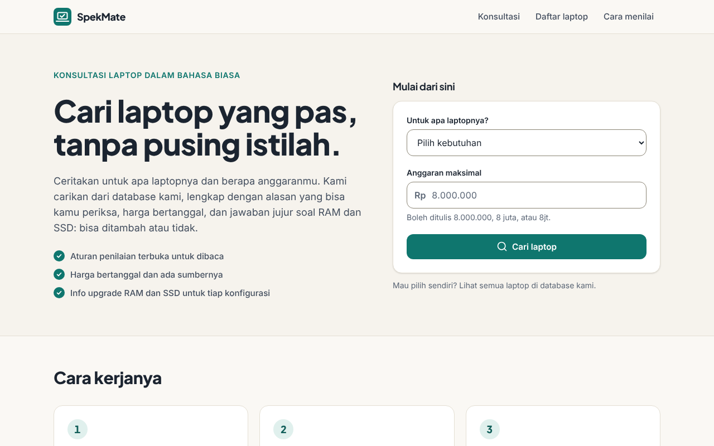
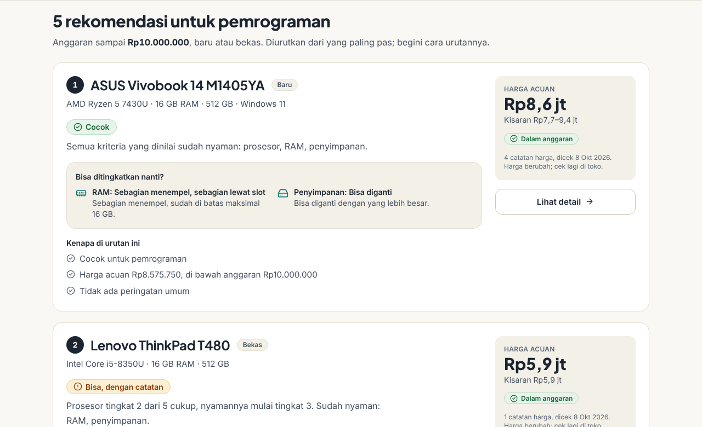
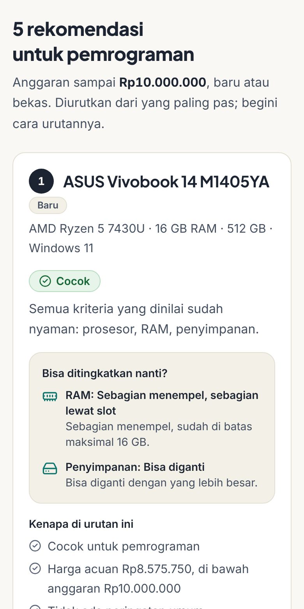
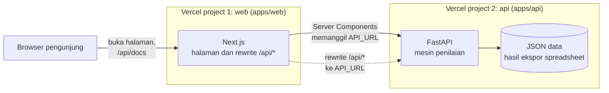

# SpekMate

SpekMate (*spek* + *mate*, teman) adalah konsultan laptop berbahasa biasa: kamu sebut kebutuhan dan anggaran,
lalu dapat sampai 5 rekomendasi dari database kecil yang dicek satu per satu, lengkap dengan alasan, harga
bertanggal, dan jawaban jujur soal RAM dan SSD: bisa ditambah atau tidak.

> **English, in short.** SpekMate is a plain-Indonesian laptop advisor. You give it a need and a budget and it
> returns up to 5 laptops from a small, hand-checked database. Verdicts come from published, rule-based thresholds
> (no AI ranking), prices carry a date and a source, and every configuration says whether its RAM and SSD can be
> upgraded. Python (FastAPI) backend, Next.js (TypeScript) frontend, deployed as two connected Vercel projects.
> The UI and the rest of this README are in Indonesian.

| Beranda | Hasil konsultasi | Di ponsel |
| --- | --- | --- |
|  |  |  |

**Daftar isi**
[Yang dilakukan](#yang-dilakukan) ·
[Arsitektur](#arsitektur) ·
[Struktur folder](#struktur-folder) ·
[Jalankan di komputer](#jalankan-di-komputer) ·
[Deploy ke Vercel](#deploy-ke-vercel-dua-project) ·
[Cara web dan API tersambung](#cara-web-dan-api-tersambung) ·
[Variabel lingkungan](#variabel-lingkungan) ·
[Memperbarui data](#memperbarui-data) ·
[Pengujian](#pengujian) ·
[Kalau ada yang tidak jalan](#kalau-ada-yang-tidak-jalan) ·
[Batasan](#batasan-yang-perlu-kamu-tahu) ·
[Rencana](#rencana-berikutnya)

## Yang dilakukan

- **Konsultasi.** Pilih kebutuhan (kuliah dan kantor, desain grafis, pemrograman, game ringan, game berat),
  isi anggaran, dan kalau perlu penyimpanan minimal dan kondisi (baru atau bekas). Hasilnya diurutkan, dan
  urutannya dijelaskan.
- **Aturan yang terbuka.** Tiap laptop dinilai dari ambang batas yang bisa dibaca di halaman *Cara menilai*
  (`/cara-menilai`). Tidak ada AI yang menentukan peringkat.
- **Harga bertanggal dan bersumber.** Yang tampil adalah kisaran dengan tanggal cek, bukan satu angka tanpa konteks.
- **Jujur soal upgrade.** Untuk tiap konfigurasi: RAM menempel di papan, ada slot, atau setengah-setengah,
  dan SSD-nya bisa diganti atau tidak.
- **Daftar laptop.** Semua laptop di database, dengan penilaian per kebutuhan dan rincian per konfigurasi.
- **Data masih kecil**: 5 model dan 8 konfigurasi. Itu disengaja; lebih baik sedikit dan dicek daripada banyak
  dan asal. Data baru ditambah lewat spreadsheet ([Memperbarui data](#memperbarui-data)).

## Arsitektur

Dua project Vercel dari satu repositori. Keduanya jalan sendiri-sendiri dan dihubungkan satu variabel:
`API_URL`.



Datanya sendiri diedit di spreadsheet (`data/source/data-laptop.xlsx`), diekspor ke JSON dengan
`scripts/export_data.py`, dan JSON itu ikut ter-deploy bersama API ([Memperbarui data](#memperbarui-data)).

**Kenapa Python untuk backend.** Mesin penilaian dan pengolahan data (spreadsheet ke JSON) paling enak ditulis
di Python, dan pekerjaan data berikutnya (misalnya mengimpor harga) tinggal melanjutkan. FastAPI membuat
dokumentasi OpenAPI otomatis, dan dari situ tipe TypeScript untuk web dibuat, jadi web dan API tidak bisa diam-diam
berbeda. Di Vercel, FastAPI jalan tanpa Docker: Vercel mencari variabel `app` di `index.py`.

**Kenapa dua project, bukan satu.** Masing-masing punya runtime sendiri (Node dan Python), bisa di-deploy dan
dilihat lognya sendiri. Vercel juga punya fitur Services untuk menjalankan beberapa layanan dalam satu project;
tidak dipakai di sini supaya penyambungannya tetap sederhana dan mudah dipahami.

## Struktur folder

```text
spekmate/
├─ apps/
│  ├─ api/                     Backend Python (FastAPI), project Vercel #1
│  │  ├─ index.py              Titik masuk Vercel: mengekspor `app`
│  │  ├─ laptop_advisor/       Mesin penilaian, rekomendasi, rute API
│  │  │  └─ data/              JSON hasil ekspor spreadsheet (ikut ter-deploy)
│  │  ├─ tests/                pytest
│  │  └─ scripts/dump_openapi.py
│  └─ web/                     Frontend Next.js (TypeScript), project Vercel #2
│     ├─ next.config.ts        Rewrite /api/* ke API_URL
│     ├─ openapi.json          Salinan kontrak API, sumber tipe TypeScript
│     └─ src/{app,components,lib}
├─ data/source/data-laptop.xlsx    Tempat data diedit (sumber kebenaran)
├─ scripts/
│  ├─ export_data.py           Spreadsheet ke JSON
│  └─ smoke_test.py            Cek web dan API tersambung setelah deploy
└─ docs/images/                Tangkapan layar untuk README ini
```

## Jalankan di komputer

Butuh **Python 3.12 atau lebih baru** (dipakai: 3.13) dan **Node.js 22**. Buka dua terminal.

**Terminal 1: API**

Windows (Command Prompt atau PowerShell). Python di dalam `.venv` dipanggil langsung, jadi tidak perlu "activate"
(skripnya hanya untuk PowerShell dan sering ditolak) dan tidak bergantung pada PATH:

```text
cd apps\api
python -m venv .venv
.venv\Scripts\python -m pip install -r requirements-dev.txt
.venv\Scripts\python -m uvicorn index:app --reload --port 8000
```

```bash
# macOS / Linux
cd apps/api
python3 -m venv .venv
source .venv/bin/activate
pip install -r requirements-dev.txt
uvicorn index:app --reload --port 8000
```

Buka <http://127.0.0.1:8000/api/docs> untuk dokumentasi interaktif.

**Terminal 2: web**

```bash
cd apps/web
npm install
npm run dev
```

Buka <http://localhost:3000>. Web memakai `http://127.0.0.1:8000` sebagai alamat API kalau `API_URL` tidak diisi.
Kalau API-mu di port lain, salin `.env.example` menjadi `.env.local` di `apps/web` dan ubah `API_URL`.

**Cek keduanya tersambung** (terminal ketiga; hanya butuh Python, tanpa install apa pun):

```bash
python scripts/smoke_test.py http://localhost:3000 --api http://127.0.0.1:8000
```

Untuk mencoba versi produksi di komputer: `npm run build && npm start` di `apps/web`, lalu jalankan perintah di atas.
API harus sudah jalan saat `npm run build`, karena beberapa halaman dibuat saat build dengan data dari API.

## Deploy ke Vercel (dua project)

> Bagian ini disusun dari dokumentasi Vercel dan belum bisa saya coba langsung, karena butuh akun Vercel. Yang
> sudah dicoba: API dan web jalan bersama secara lokal lewat konfigurasi rewrite yang sama, dan `smoke_test.py`
> lulus. Di Vercel, rewrite dijalankan oleh router Vercel, bukan oleh server Next.js lokal, jadi detail itu baru
> terbukti di deploy pertamamu. Jalankan `smoke_test.py` setelah deploy; kalau ada yang salah, ia menyebut apa yang
> perlu diperbaiki.

### 1. Taruh kode di GitHub

```bash
git init
git add .
git commit -m "SpekMate: versi pertama"
git branch -M main
git remote add origin https://github.com/USERNAME/spekmate.git
git push -u origin main
```

### 2. Project API (deploy dulu yang ini)

1. Di dasbor Vercel: **Add New… → Project**, pilih repositori tadi.
2. Beri nama, misalnya `spekmate-api`. Di **Root Directory** klik **Edit** dan pilih `apps/api`.
   Vercel mengenali FastAPI dari `requirements.txt` dan `index.py`; pastikan **Framework Preset** menunjukkan
   FastAPI, dan biarkan pengaturan lain bawaan.
3. Klik **Deploy**.
4. Salin domain produksinya (kartu **Domains**), misalnya `https://spekmate-api.vercel.app`. Buka
   `…/api/health` (harus tampil `{"status":"ok"}`) dan `…/api/meta` (harus menampilkan jumlah model dan konfigurasi).
   `/api/health` hanya menandakan fungsinya hidup; `/api/meta` membuktikan datanya ikut ter-deploy dan terbaca.
   `…/api/docs` menampilkan dokumentasi API.

### 3. Project web

1. **Add New… → Project**, pilih repositori yang sama lagi.
2. Nama `spekmate-web`. **Root Directory**: `apps/web`. Framework: Next.js (otomatis).
3. Buka **Environment Variables** dan tambahkan:
   - **Key**: `API_URL`
   - **Value**: alamat project API dari langkah 2, **tanpa garis miring di akhir dan tanpa `/api`**,
     misalnya `https://spekmate-api.vercel.app`
   - Biarkan semua environment tercentang (Production, Preview, Development).
4. Klik **Deploy**.

**Build web membutuhkan API yang sudah hidup.** Beranda, *Cara menilai*, dan tiap halaman laptop dibuat saat build
dengan data dari API. Jadi `API_URL` yang salah, API yang belum selesai deploy, atau Deployment Protection di API
membuat build web gagal (pesan seperti "Failed to collect page data for /laptop/[id]"). Itu disengaja: lebih baik
gagal di awal daripada situs yang tampak jalan tetapi kosong. Build yang gagal tidak mengganti situs yang sedang
tayang; Vercel tetap memakai deploy terakhir yang berhasil.

Kalau `API_URL` terlupa, build berhenti dengan pesan yang menjelaskan apa yang harus diisi.

### 4. Cek hasilnya

```bash
python scripts/smoke_test.py https://spekmate-web.vercel.app --api https://spekmate-api.vercel.app
```

Enam pemeriksaan: API langsung sehat dan datanya terbaca, beranda terbuka, web meneruskan `/api/...` ke API, kebutuhan dan
rekomendasi bisa diambil lewat web, halaman `/konsultasi` benar-benar memuat data dari API, dan dokumentasi API
terbuka lewat web. Kode keluarnya 0 kalau semua lulus.

### Hal yang sering terlewat

- **Mengubah `API_URL` butuh deploy ulang project web.** Alamat itu dibaca saat build (untuk rewrite).
  Di **Deployments**, buka menu `⋯` pada deploy terbaru, pilih **Redeploy**, dan matikan *Use existing Build Cache*.
- **Deployment Protection.** Kalau project API diberi perlindungan masuk (Settings → Deployment Protection),
  web hanya menerima halaman login Vercel, bukan JSON. Pakai domain produksi (`nama-api.vercel.app`), bukan alamat
  per-deploy yang panjang, dan matikan perlindungan untuk produksi kalau halaman login masih muncul.
- **Setiap push membangun kedua project, bersamaan.** Wajar untuk project sekecil ini. Kalau perubahanmu menyentuh
  API dan web sekaligus (misalnya endpoint baru yang dipakai halaman), build web bisa lebih dulu menemui API versi
  lama dan gagal. Tunggu deploy API selesai, lalu Redeploy project web. Kalau ingin memisahkan, Vercel punya
  pengaturan *Ignored Build Step* di Settings tiap project.
- **Domain sendiri.** Pasang di project web (Settings → Domains), lalu isi `NEXT_PUBLIC_SITE_URL` dengan alamat
  itu supaya tautan pratinjau benar. `API_URL` tidak perlu berubah.

## Cara web dan API tersambung

Penyambungannya ada di tiga tempat, dan semuanya membaca `API_URL`:

1. **Server Components memanggil API langsung** (`apps/web/src/lib/api.ts`). Halaman dibuat di server Next.js,
   yang mengambil data dari `${API_URL}/api/...`. Tidak ada CORS dan tidak ada lompatan tambahan.
2. **Rewrite untuk browser** (`apps/web/next.config.ts`). Di domain web, `/api/*` diteruskan ke project API,
   jadi pengunjung bisa membuka `https://domain-web/api/docs`, dan `fetch("/api/...")` dari browser nanti tetap satu
   origin.

   ```ts
   const apiUrl = resolveApiUrl(process.env.API_URL, { onVercel: Boolean(process.env.VERCEL) });
   // ...
   return [{ source: "/api/:path*", destination: `${apiUrl}/api/:path*` }];
   ```

3. **Satu pemeriksa untuk keduanya** (`apps/web/src/lib/api-url.ts`). Alamatnya harus diawali `http(s)://`, tidak
   boleh berakhir `/api`, dan di Vercel tidak boleh kosong. Salah isi berarti build gagal dengan pesan yang jelas.

Supaya kedua sisi tidak berbeda diam-diam, API menerbitkan dokumen OpenAPI. Salinannya ada di `apps/web/openapi.json`
dan dipakai membuat tipe TypeScript (`src/lib/api-schema.d.ts`). Ada tes yang gagal kalau API berubah tetapi salinan
atau tipenya belum diperbarui ([Pengujian](#pengujian)).

Kalau ada klien lain yang memanggil API langsung dari browser di domain berbeda, isi `CORS_ORIGINS` di project API.
Untuk web ini tidak diperlukan.

## Variabel lingkungan

| Variabel | Di project | Wajib | Isi | Catatan |
| --- | --- | --- | --- | --- |
| `API_URL` | web | Ya, di Vercel | `https://nama-api.vercel.app` | Tanpa `/` di akhir dan tanpa `/api`. Ubah, lalu Redeploy. Lokal bawaannya `http://127.0.0.1:8000`. |
| `NEXT_PUBLIC_SITE_URL` | web | Tidak | Alamat publik situs | Untuk tautan pratinjau. Bawaannya domain produksi Vercel. Tanpa `https://` pun diterima. |
| `NEXT_PUBLIC_REPO_URL` | web | Tidak | URL repositori GitHub | Kalau diisi, tautannya muncul di footer. Dibaca saat build. |
| `CORS_ORIGINS` | api | Tidak | Origin dipisah koma | Bawaan: `http://localhost:3000` dan `http://127.0.0.1:3000`. |
| `CACHE_SECONDS` | api | Tidak | Detik | Lama CDN menyimpan jawaban GET. Bawaan 300; `0` mematikan cache. |

Tidak ada rahasia di proyek ini; semua nilai di atas aman dilihat orang lain.

## Memperbarui data

Spreadsheet `data/source/data-laptop.xlsx` adalah tempat data diedit. API tidak membaca Excel; ia membaca JSON
hasil ekspor.

```bash
pip install -r scripts/requirements.txt     # sekali saja
python scripts/export_data.py               # spreadsheet ke apps/api/laptop_advisor/data/*.json
python scripts/export_data.py --check       # gagal kalau JSON tertinggal dari spreadsheet
```

1. Edit spreadsheet, lalu **simpan di Excel atau LibreOffice** supaya rumusnya terhitung ulang (skrip membaca nilai
   hasil hitung).
2. Jalankan ekspor. Skrip berhenti dengan pesan jelas kalau tata letak tab berubah, dan melaporkan catatan data
   (ID ganda, CPU atau GPU yang tidak terdaftar, harga tanpa tanggal, dan sebagainya). Jumlah catatannya juga
   tampil di `/api/meta` sebagai `data_issue_count`.
3. Jalankan `pytest` di `apps/api`. Tes "golden" membandingkan hasil mesin dengan perhitungan di spreadsheet, jadi
   perubahan aturan yang tidak konsisten ketahuan di sini.
4. Commit dan push. Kedua project akan dibangun ulang.

**Berapa lama sampai data baru tampil?** Hasil konsultasi selalu mengambil data langsung dari API, jadi memakai data
baru begitu deploy API selesai. Halaman lain (beranda, daftar dan detail laptop, footer) menyimpan jawaban API
sebentar: di API selama `CACHE_SECONDS` (bawaan 5 menit) dan di web selama `DATA_REVALIDATE_SECONDS` (5 menit, di
`apps/web/src/lib/api.ts`). Jadi biasanya data baru terlihat dalam 5 sampai 10 menit. Halaman dibuat ulang di belakang
layar, jadi satu kunjungan pertama setelah waktunya habis bisa masih melihat versi lama. Karena kedua project dibangun
bersamaan, build web kadang sempat membaca API versi lama; halamannya menyusul sendiri dalam beberapa menit.

## Mengubah API lalu menyegarkan tipe web

Setelah mengubah bentuk jawaban API:

```bash
python apps/api/scripts/dump_openapi.py       # tulis ulang apps/web/openapi.json
cd apps/web && npm run gen:types               # buat ulang src/lib/api-schema.d.ts
```

`npm run check:api-types` memeriksa tipe sudah sesuai tanpa menulis apa pun.

## Pengujian

```bash
# API (dari apps/api, venv aktif)
pytest
ruff check .

# Web (dari apps/web)
npm test
npm run typecheck
npm run lint
npm run check:api-types
```

Yang diuji, singkatnya:

- **Mesin penilaian** dibandingkan dengan perhitungan di spreadsheet (tes "golden"), ditambah kasus tepi pada data
  sintetis.
- **API**: bentuk jawaban, validasi masukan, dan kontrak OpenAPI terhadap `apps/web/openapi.json`.
- **Ekspor data** dan **skrip `smoke_test.py`** (diuji terhadap server palsu yang meniru tiap kegagalan: halaman login
  Vercel, rewrite hilang, API mati, dan seterusnya).
- **Web**: komponen, format angka, pembacaan isian form, klien API, dan **kontras warna** terang dan gelap
  (teks minimal 4,5:1, tepi kolom isian dan cincin fokus minimal 3:1) dibaca langsung dari `globals.css`.

## Kalau ada yang tidak jalan

Mulai dari `python scripts/smoke_test.py …`. Ia membaca pola lulus dan gagalnya, dan menyebut dugaan penyebabnya.

| Gejala | Biasanya karena | Perbaikan |
| --- | --- | --- |
| Di Windows: `'uvicorn' is not recognized` | `uvicorn` belum terpasang di Python yang dipakai, atau `.venv` belum aktif (`Activate.ps1` hanya jalan di PowerShell, bukan Command Prompt) | Pakai perintah Windows di [Jalankan di komputer](#jalankan-di-komputer): `pip install` lewat `.venv\Scripts\python -m pip`, lalu `.venv\Scripts\python -m uvicorn index:app --reload --port 8000` |
| Build web gagal: "API_URL belum diisi" | Variabel belum ada untuk environment yang dipakai build | Settings → Environment Variables, tambahkan `API_URL`, centang semua environment, Redeploy |
| Build web gagal: "API_URL jangan diakhiri /api" | Nilai berakhir `/api` | Isi alamat dasarnya saja |
| Build web gagal: "Failed to collect page data for /laptop/[id]" | Build tidak bisa mengambil data dari API: `API_URL` salah, API belum selesai deploy, atau Deployment Protection di API | Buka `API_URL/api/meta` di browser; harus tampil JSON. Perbaiki, lalu Redeploy |
| `…/api/docs` di domain web menjawab 404 | `API_URL` menunjuk ke alamat yang tidak punya jalur itu (bukan project API), atau project API tidak terdeteksi sebagai FastAPI | Samakan `API_URL` dengan domain project API, cek Framework Preset FastAPI, lalu Redeploy project web |
| `…/api/health` OK, tetapi `…/api/meta` error 500 | Folder `apps/api/laptop_advisor/data` tidak ikut ter-deploy atau kosong | Jalankan `python scripts/export_data.py`, commit hasilnya, deploy ulang project API |
| Halaman Konsultasi: "Data laptop belum bisa diambil" | `API_URL` salah, API mati, atau Deployment Protection di API | Cek `…/api/health` langsung; lihat Logs project web (baris `[api]`) |
| Smoke test menunjuk halaman login Vercel | Deployment Protection | Pakai domain produksi, atau matikan perlindungannya |
| Rewrite jalan, tetapi `/konsultasi` gagal | `API_URL` terbaca berbeda saat build dan saat berjalan | Pastikan variabel ada untuk Production, lalu Redeploy |
| Setelah mengubah `API_URL`, hasilnya sama saja | Alamat dibaca saat build | Redeploy project web |
| Permintaan pertama ke API lambat | Fungsi baru bangun | Wajar; web menunggu sampai 10 detik, lalu tampil pesan sopan |
| Data baru belum tampil | Cache singkat (sekitar 5 sampai 10 menit) | Tunggu sebentar; lihat [Memperbarui data](#memperbarui-data) |

## Batasan yang perlu kamu tahu

- **Deploy ke Vercel belum saya coba sendiri**, karena butuh akun Vercel. Cara kerjanya mengikuti dokumentasi Vercel
  untuk FastAPI dan Next.js (dibaca Oktober 2026) dan sisanya sudah diuji berjalan bersama secara lokal.
  `scripts/smoke_test.py` ada untuk membuktikannya di deploy pertamamu.
- **Hasil konsultasi butuh JavaScript.** Hasilnya dimuat bertahap (streaming). Tanpa JavaScript, form tetap terkirim
  dan halaman terbuka, tetapi daftar hasilnya tidak tampil.
- **Data kecil dan harga berubah.** Rekomendasi hanya berasal dari 5 model di database, bukan dari seluruh pasar.
  Harga bertanggal dan bisa sudah basi; web selalu mengingatkan untuk mengecek di toko.
- **Ketersediaan nama "SpekMate" belum diperiksa tuntas.** Pencarian web singkat tidak menemukan produk dengan nama
  itu, tetapi domain, akun media sosial, dan merek dagangnya belum dicek. Kalau nama diganti lagi: nama dan slogan
  ada di `apps/web/src/lib/site.ts`; sisanya `apps/web/src/app/icon.svg`, `apps/web/package.json`, judul API di
  `apps/api/laptop_advisor/main.py` (lalu jalankan ulang `dump_openapi.py` dan `npm run gen:types`), teks di
  `scripts/smoke_test.py`, dan README ini.
- **Kalimat dari backend menulis "1000 GB", sedangkan tampilan web menulis "1 TB".** Belum diseragamkan.
- **`npm install` menampilkan peringatan bahwa ESLint 9 "no longer supported".** Itu hanya pemberitahuan bahwa 9.x
  sudah masuk mode pemeliharaan. ESLint 10 belum dipakai karena plugin bawaan `eslint-config-next` 16.4 baru
  menyatakan dukungan sampai ESLint 9; naikkan keduanya bersamaan setelah ada versi yang mendukung.
- **Belum ada lisensi.** Tambahkan berkas `LICENSE` sebelum repositori dibuka untuk umum.

## Rencana berikutnya

- Kamus dan bagian *Belajar*: arti RAM 8, 16, 32 GB, jenis SSD, istilah prosesor, dan seterusnya dalam bahasa biasa.
- Panduan membeli laptop bekas (apa yang dicek, tanda bahaya).
- Bandingkan dua sampai tiga laptop berdampingan.
- Ulasan berbintang.
- Lebih banyak laptop di database.

## Tentang data

Spesifikasi diambil dari halaman resmi pabrikan dan manual servis; harga dari toko online, dengan tanggal dan
sumbernya. Kalau sebuah nilai tidak ketahuan, datanya ditulis "belum diketahui", bukan ditebak. Semua merek dan
nama produk milik pemiliknya masing-masing; proyek ini tidak berafiliasi dengan mereka.
